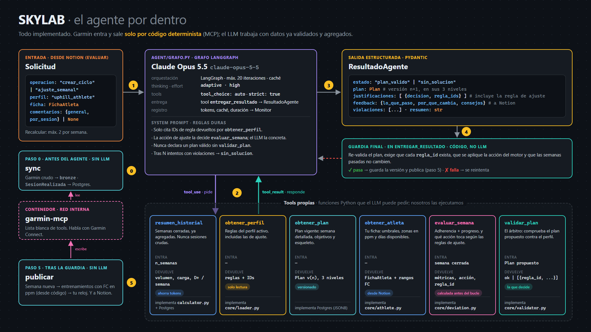

# SKYLAB · Trail Running Coaching

Coach personal de running/trail basado en un agente de IA. Planifica ciclos
completos de entrenamiento según una metodología explícita, evalúa cada
semana lo que realmente entrené (adherencia y progreso) y ajusta lo que
viene, justificando cada decisión con el ID de la regla que la produjo.

Tiene dos modos: **construcción** (progresar sin carrera de referencia) y
**competición** (llegar en forma a una carrera). Nunca inventa metodología:
la aplica. Si no puede cumplir las restricciones, lo dice en vez de producir
un plan bonito e incoherente.

Visión completa: [`docs/vision.md`](docs/vision.md). Entradas del sistema:
[`docs/entradas.md`](docs/entradas.md). Decisiones:
[`docs/decisions.md`](docs/decisions.md).

Este proyecto es también un ejercicio de aprendizaje de agentes de IA y MCP.

## Principio de diseño

El sistema es un motor híbrido:

- **Motor determinista (Python)**: calcula carga/volumen/intensidad,
  valida restricciones de la metodología activa, detecta desviación entre
  plan y realidad. Es la única autoridad sobre "¿esto cumple la
  metodología?". Se testea con unit tests.
- **Agente LLM**: interpreta el objetivo del usuario, propone la
  composición de la rutina y los ajustes, evalúa el progreso en lenguaje
  natural y redacta la justificación citando el ID de regla exacto que el
  motor determinista usó. Nunca decide por sí solo si algo es válido —
  propone dentro del espacio que el motor aprueba o rechaza.

## Flujo

Uso el sistema desde **Notion**; el servicio `skylab-notion` lo consulta
cada 3 minutos y habla con el resto solo por sus APIs:

```
Notion ◀──▶ skylab-notion ──▶ skylab-api  /plan · /semana/ajustar · /atleta · /monitor
                     │                  agente LLM (propone) + motor determinista (decide)
                     │                  + perfiles YAML + PostgreSQL (bronze · silver · gold)
                     └──────▶ skylab-sync /sync ◀── garmin-mcp ◀── Garmin Connect
                                          /publicar ──▶ garmin-mcp ──▶ calendario ──▶ reloj
```

La semana tipo:
1. Entreno con el reloj.
2. Comento cada sesión en Notion.
3. El lunes marco **Evaluar** en la semana cerrada.
4. El agente ajusta la siguiente semana y escribe el feedback.
5. La semana nueva llega al reloj y a Notion.

La página **Monitor** muestra el coste del agente, los tokens y la carga semanal (plan frente a hecho).

Contrato de la API: [`docs/api.md`](docs/api.md).




## Estructura del proyecto

Workspace de uv: cada carpeta es un paquete con su `pyproject.toml` y sus
scripts directamente dentro (`from core.training import Plan`).

```
core/           skylab-core         modelos (training, methodology, athlete) y motor determinista
                                      (loader, calculator, validator, deviation). Sin IO.
persistence/    skylab-persistence  Postgres: modelos, repositorio, migraciones Alembic y vistas silver/gold
sync/           skylab-sync         sync Garmin → Postgres vía MCP (garmin.py, app.py)
notion/         skylab-notion       interfaz del atleta en Notion (consulta Notion cada 3 min; solo APIs)
agent/          skylab-agent        agente LLM (grafo LangGraph, tools, guardia, servicio) + api.py
methodology/    Perfiles de metodología (YAML): uphill_athlete (activo) y ejemplo_didactico
tests/          Tests de todo el workspace
docs/           Visión, decisiones, contrato de la API y diagramas
docker/         Inicialización de Postgres
```

## Estado actual

En uso real desde la semana del 19/10/2026: primer ciclo de base con el
perfil Uphill Athlete y los umbrales del test del 18/10 (AeT 164, LT 179).

Hecho, con tests:
- **Motor determinista:** reglas, tipos de semana, disponibilidad del atleta y zonas por umbral.
- **Agente:** LangGraph con guardia final y feedback semanal.
- **Persistencia:** Postgres con planes versionados y ficha del atleta.
- **Garmin:** sync de actividades y publicación de la semana en el reloj (FC en ppm).
- **Notion:** ficha, semanas, entrenamientos, Evaluar/Recalcular y monitor.
- **Pipeline medallón:** `bronze_garmin_actividad`, más vistas `silver_*` y `gold_*`.

Pendiente:
- Copias de seguridad de Postgres.
- Despliegue en un VPS.
- Evaluar automático los lunes.
- Sincronizar las tablas Carreras y Tests.
- Sesiones de fuerza.
- Crear un ciclo desde Notion.

## Setup

Entorno y dependencias con [uv](https://docs.astral.sh/uv/) (Python 3.12,
fijado en `.python-version`; versiones exactas en `uv.lock`):

```bash
uv sync --all-packages   # .venv con los cinco paquetes + grupo dev
uv run pytest            # tests (los de Postgres se saltan sin TEST_DATABASE_URL)
uv add --package skylab-agent <paquete>   # dependencia para un paquete concreto
```

## Docker

Una imagen por servicio, cada una con solo su paquete:

```bash
docker compose up -d --build                    # postgres + skylab-api (127.0.0.1:8000)
docker compose --profile garmin up -d --build   # + skylab-sync + garmin-mcp
docker compose run --rm --build test            # todos los tests, incluidos los de Postgres
docker compose --profile garmin --profile notion up -d --build   # + skylab-notion
docker compose exec skylab-sync python -m sync   # sync manual
```

`garmin-mcp` necesita tus credenciales de Garmin en `secrets/` (ignorado por
git) y un primer login interactivo:

```bash
mkdir -p secrets
printf '%s' 'tu_email' > secrets/garmin_email.txt
printf '%s' 'tu_password' > secrets/garmin_password.txt
docker compose --profile garmin run --rm garmin-mcp
```

`skylab-notion` necesita el token de una conexión interna de Notion en
`secrets/notion_token.txt` y los ids de las bases en `.env` (`NOTION_DS_*`,
ver `.env.example`). Con `NOTION_SIMULACION=1` lee pero no escribe.
