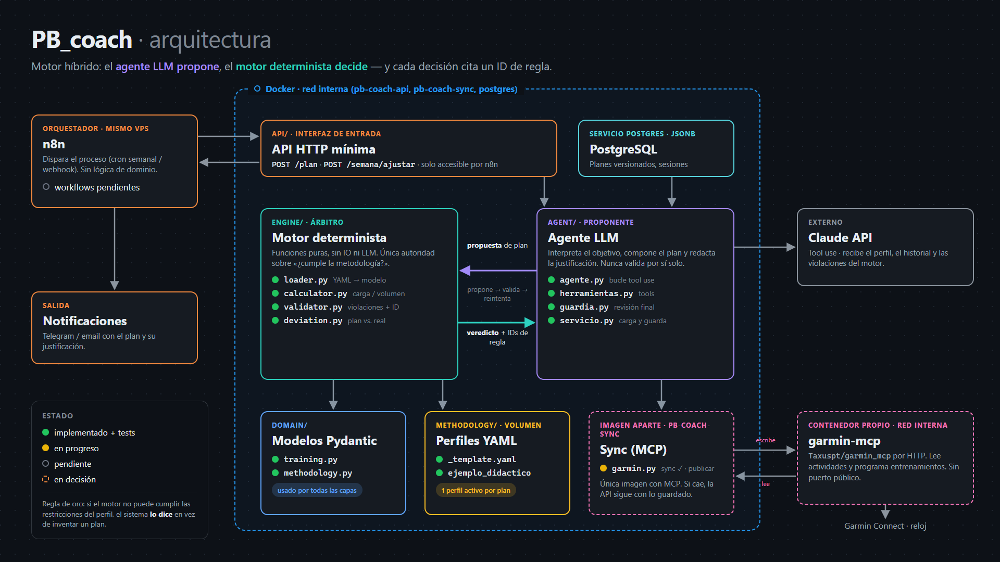

# SKYLAB · Trail Running Coaching

Coach personal de running/trail basado en un agente de IA. Planifica ciclos
completos de entrenamiento según una metodología explícita, evalúa cada
semana lo que realmente entrené (adherencia y progreso) y ajusta lo que
viene, justificando cada decisión con el ID de la regla que la produjo.

Tiene dos modos: **construcción** (progresar sin carrera de referencia) y
**competición** (llegar en forma a una carrera). Nunca inventa metodología:
la aplica. Si no puede cumplir las restricciones, lo dice en vez de producir
un plan bonito e incoherente.

Visión completa: [`docs/vision.md`](docs/vision.md). Entradas del sistema:
[`docs/entradas.md`](docs/entradas.md). Decisiones:
[`docs/decisions.md`](docs/decisions.md).

Este proyecto es también un ejercicio de aprendizaje de agentes de IA y MCP.

## Principio de diseño

El sistema es un motor híbrido:

- **Motor determinista (Python)**: calcula carga/volumen/intensidad,
  valida restricciones de la metodología activa, detecta desviación entre
  plan y realidad. Es la única autoridad sobre "¿esto cumple la
  metodología?". Se testea con unit tests.
- **Agente LLM**: interpreta el objetivo del usuario, propone la
  composición de la rutina y los ajustes, evalúa el progreso en lenguaje
  natural y redacta la justificación citando el ID de regla exacto que el
  motor determinista usó. Nunca decide por sí solo si algo es válido —
  propone dentro del espacio que el motor aprueba o rechaza.

## Flujo

```
POST skylab-sync /sync ─────────▶ garmin-mcp ◀── Garmin Connect  (actividades → Postgres)
POST skylab-api  /semana/ajustar ─┐
POST skylab-api  /plan ───────────┤
                                    ▼
                    skylab-api: agente LLM (propone) + motor determinista (decide)
                                  + perfiles YAML + PostgreSQL (planes versionados)
POST skylab-sync /publicar ─────▶ garmin-mcp ──▶ calendario de Garmin ──▶ reloj
```

Por ahora el ciclo se lanza a mano (ver `docs/api.md`); la programación
automática está pendiente de decidir.



## Estructura del proyecto

Workspace de uv: cada carpeta es un paquete con su `pyproject.toml` y sus
scripts directamente dentro (`from core.training import Plan`).

```
core/           skylab-core         modelos (training, methodology) y motor determinista
                                      (loader, calculator, validator, deviation). Sin IO.
persistence/    skylab-persistence  Postgres: modelos, repositorio y migraciones Alembic
sync/           skylab-sync         sync Garmin → Postgres vía MCP (garmin.py, app.py)
agent/          skylab-agent        agente LLM (bucle, tools, guardia, servicio) + api.py
methodology/    Perfiles de metodología (YAML)
tests/          Tests de todo el workspace
docs/           Visión, decisiones, contrato de la API y diagramas
docker/         Inicialización de Postgres
```

## Estado actual

- Hecho: modelos de dominio alineados con la visión (modos construcción /
  competición, tres niveles de detalle, sesión planificada vs. realizada,
  reglas de ajuste), loader de perfiles, perfil didáctico, API con `/health`
  y stack Docker (postgres + skylab + garmin-mcp), todo con tests.
- Hecho también: motor determinista completo (`core/calculator.py`,
  `validator.py`, `deviation.py`) y Postgres en el stack.
- Hecho también: persistencia en Postgres (`persistence/`, SQLAlchemy +
  migraciones Alembic en `persistence/migrations/`).
- Hecho también: sync de Garmin (`sync/`) y agente LLM (`agent/`:
  bucle de tool use con Claude, guardia final y servicio que persiste),
  expuesto en la API (`POST /plan`, `POST /semana/ajustar`); el sync es un
  servicio aparte (`skylab-sync`, `POST /sync`).
- Hecho también: publicar la semana en el reloj (`POST /publicar`).
- Siguiente: migrar el agente a LangGraph, pipeline de observabilidad,
  programación automática del ciclo semanal y el primer perfil real.

## Setup

Entorno y dependencias con [uv](https://docs.astral.sh/uv/) (Python 3.12,
fijado en `.python-version`; versiones exactas en `uv.lock`):

```bash
uv sync --all-packages   # .venv con los cuatro paquetes + grupo dev
uv run pytest            # tests (los de Postgres se saltan sin TEST_DATABASE_URL)
uv add --package skylab-agent <paquete>   # dependencia para un paquete concreto
```

## Docker

Una imagen por servicio, cada una con solo su paquete:

```bash
docker compose up -d --build                    # postgres + skylab-api (127.0.0.1:8000)
docker compose --profile garmin up -d --build   # + skylab-sync + garmin-mcp
docker compose run --rm --build test            # todos los tests, incluidos los de Postgres
docker compose exec skylab-sync python -m sync   # sync manual
```

`garmin-mcp` necesita tus credenciales de Garmin en `secrets/` (ignorado por
git) y un primer login interactivo:

```bash
mkdir -p secrets
printf '%s' 'tu_email' > secrets/garmin_email.txt
printf '%s' 'tu_password' > secrets/garmin_password.txt
docker compose --profile garmin run --rm garmin-mcp
```
